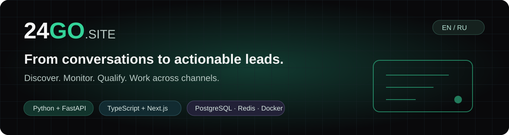
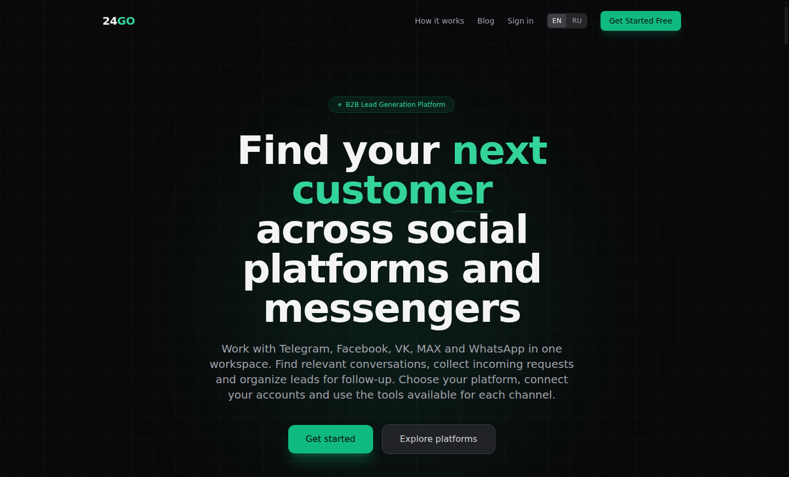
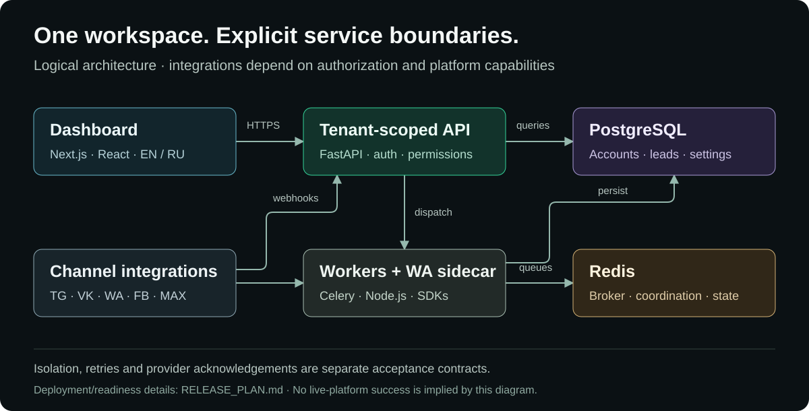
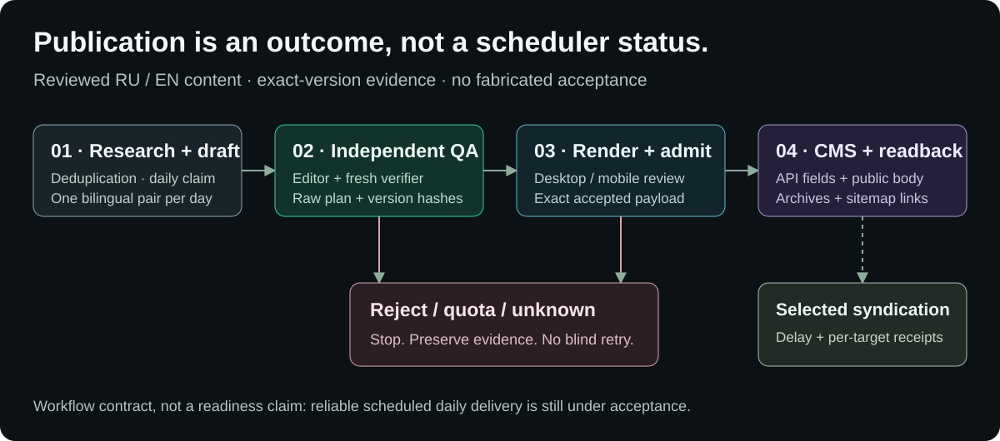

<p align="center"></p>

<p align="center"><strong>English</strong> · <a href="README.ru.md">Русский</a></p>
<p align="center"><a href="https://www.24go.site/?locale=en">Website</a> · <a href="https://www.24go.site/blog?locale=en">Engineering articles</a> · <a href="docs/RELEASE_READINESS_AUDIT.md">Readiness audit</a> · <a href="RELEASE_PLAN.md">Roadmap</a></p>

# 24GO.SITE

**A multi-platform workspace for social discovery, monitoring and lead operations — with an independently reviewed editorial pipeline.**

24GO brings channel-specific tools into one dashboard: find relevant communities, collect incoming opportunities, organize leads and contacts, and configure qualification rules. Telegram, VK, WhatsApp, Facebook and MAX have different APIs, prerequisites and supported workflows; they are not interchangeable senders.

> **Release maturity:** active development with a live deployment. Installed functionality, prepared candidates and real external-platform acceptance are tracked separately. This README is not a claim that every integration or the entire unattended publishing cycle is production-accepted.

## Why this project

- **Channel-aware workflows:** platform namespaces and explicit account context, rather than one generic screen pretending all providers work the same way.
- **Lead operations:** monitoring, source-aware incoming leads, rules/scoring, contacts, filters and exports.
- **Tenant boundaries:** authenticated APIs and server-side permissions; complete PostgreSQL/object-isolation acceptance remains on the release plan.
- **Truthful delivery states:** queued, accepted, failed and unknown mean different things. A provider acknowledgement is not a delivered/read receipt.
- **Reviewed publishing:** bilingual drafts, independent editing and verification, real browser QA, exact-version CMS admission and public readback.
- **Release discipline:** bounded changes, rollback handles, explicit readiness gates and separate candidate source.

## Product preview



*Real public landing-page capture, not a mock dashboard or a performance benchmark. The Russian version is shown in [README.ru.md](README.ru.md).*

## Platform capabilities and boundaries

| Platform | Workflow represented in the project | Important boundary |
|---|---|---|
| **Telegram** | Discovery, selected targets, monitoring and lead processing | Real account/group acceptance requires authorized test resources |
| **VK** | Community events, selected wall/comments and scoped discovery | `groups.search` needs suitable user authorization; community credentials are not equivalent |
| **WhatsApp** | Connection/group tools and explicitly confirmed single-recipient text | No bulk-campaign readiness claim. Durable unknown-send protection is a separate, not-yet-installed candidate |
| **Facebook** | Group monitoring and Marketplace workflows | Session, selectors and real consumer results still require external acceptance; no FB sender promise |
| **MAX** | Bot onboarding, explicit webhook subscription and incoming leads | A configured webhook is not proof that real updates were received |

Shared modules include leads, contacts, settings and role-aware operations. A shared page or a working route alone does not prove an end-to-end provider workflow. See the [full readiness matrix](docs/RELEASE_READINESS_AUDIT.md) for the current evidence boundary.

## Architecture



The diagram is a logical component overview, not a network inventory or live-platform certification. Long-running workloads use workers; the WA transport is a private Node.js sidecar. Provider capabilities, tenant predicates and acknowledgement contracts must be checked at their actual boundaries.

### Technology and source languages

| Layer | Technology |
|---|---|
| Web interface | TypeScript / TSX, JavaScript, Next.js, React, Tailwind CSS |
| API and business logic | Python, FastAPI, SQLAlchemy, Pydantic |
| Background execution | Python, Celery, Redis |
| WA sidecar | TypeScript, Node.js, Baileys |
| Persistence and schema | PostgreSQL, SQL |
| Operations and configuration | Docker, Compose/YAML, Bash |
| Documentation and graphics | Markdown, HTML, SVG |

**Interface/documentation languages:** English and Russian. Other UI locales are not claimed supported by this repository.

## Editorial publishing



The host automation keeps research/generation separate from permission to publish. Rejected versions, quota failures and unknown writes must not become fabricated success. Syndication has its own delay, per-platform checkpoints and authorization.

The CMS path has delivered independently accepted RU/EN content, and the Telegraph size repair has produced a verified target. **Reliable daily unattended delivery is still an open acceptance gate**, not something inferred from an enabled cron job. Start with the [automation guide](automation/README.md).

## Read the engineering notes

These articles describe specific techniques and limitations, not blanket promises about installed product features.

| Topic | English | Русский |
|---|---|---|
| CRM CSV exports and suspicious-field quarantine | [Read](https://www.24go.site/blog/crm-csv-export-formula-quarantine?locale=en) | [Читать](https://www.24go.site/blog/crm-csv-export-formula-quarantine?locale=ru) |
| Telegram webhook secret-token validation | [Read](https://www.24go.site/blog/telegram-webhook-secret-token-validation?locale=en) | [Читать](https://www.24go.site/blog/telegram-webhook-secret-token-validation?locale=ru) |
| Telegram group migration and CRM chat identity | [Read](https://www.24go.site/blog/telegram-group-migration-crm-chat-id?locale=en) | [Читать](https://www.24go.site/blog/telegram-group-migration-crm-chat-id?locale=ru) |

[Browse all articles](https://www.24go.site/blog?locale=en).

## Explore the source

```text
services/
  dashboard/        Next.js interface
  backend/          FastAPI application
  worker/           Background consumers
  wa-sidecar/       Private WA transport
  bot/              Telegram bot service
automation/
  scripts/          Operator-run publishing and reservation tools
  skills/statejnik/ Review, CMS and serialization modules
proposals/
  wa-durable-v34/   Prepared candidate — NOT installed
docs/               Architecture, audit, completion plan and visual assets
```

### Local frontend development

Use the project's lockfile and the runtime requirements in its Dockerfiles. Point the frontend at **your isolated local API**, not production. The URL below is an example for a local API listening on port8000; starting the frontend does not start the backend, database or workers.

```bash
cd services/dashboard
npm ci
API_URL=http://127.0.0.1:8000 NEXT_PUBLIC_API_URL=http://127.0.0.1:8000 npm run dev
```

On PowerShell, set `$env:API_URL` and `$env:NEXT_PUBLIC_API_URL` to that local API before `npm run dev`.

For isolated host-automation contracts, see [automation/README.md](automation/README.md). Do not run backend fixtures against inherited production PostgreSQL/Redis or start social workflows just to test the interface. Historical [DEPLOY.md](DEPLOY.md) contains superseded hosting instructions; it is not the current production runbook.

## Roadmap and contribution

Latest installed release: [v39 — sitemap/robots and search eligibility](docs/INSTALLED_RELEASE_V39.md), retaining [v38 proxy safety](docs/INSTALLED_RELEASE_V38.md) and [v37 lead-reference boundaries](docs/INSTALLED_RELEASE_V37.md). Technical crawlability is not guaranteed indexing, AI citation or whole-product readiness.

The [completion plan](docs/RELEASE_COMPLETION_PLAN.md) defines bounded work packages, dependencies and exit criteria. The [audit](docs/RELEASE_READINESS_AUDIT.md) separates installed behavior from unverified scenarios. Prepared changes under `proposals/` must not be mistaken for active runtime code.

Contributions should include a reproducible issue, a scoped patch and evidence for the affected contract. Never commit tokens, `.env`, cookies, sessions, customer records or private provider responses. Never send unsolicited messages, charge users or modify real accounts merely to produce a green test.

## License and third-party services

A repository-wide license has not yet been declared. Do not infer a project-wide MIT/Apache grant from a subcomponent license; [Statejnik's component license](statejnik/LICENSE.md) applies in its own scope. External libraries and platform names remain subject to their respective licenses, terms and authorization requirements. No platform endorsement, guaranteed lead volume, indexing or delivery is implied.
