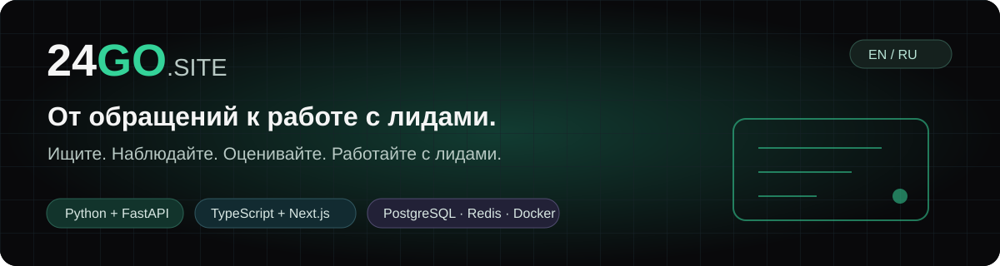
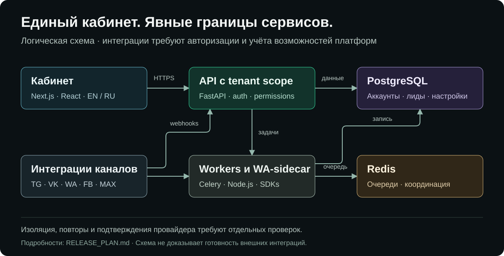
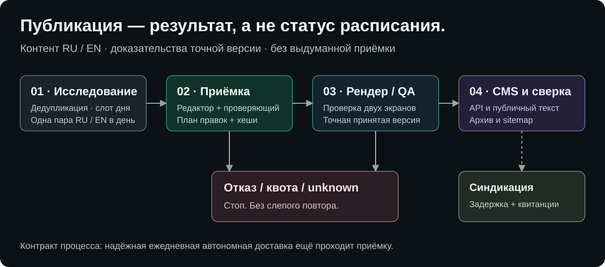

<p align="center"></p>

<p align="center"><a href="README.md">English</a> · <strong>Русский</strong></p>
<p align="center"><a href="https://www.24go.site/?locale=ru">Сайт</a> · <a href="https://www.24go.site/blog?locale=ru">Инженерные статьи</a> · <a href="docs/RELEASE_READINESS_AUDIT.md">Аудит готовности</a> · <a href="RELEASE_PLAN.md">План развития</a></p>

# 24GO.SITE

**Единый кабинет для поиска сообществ, мониторинга обращений и работы с лидами — с отдельным редакционно-публикационным конвейером.**

24GO объединяет инструменты разных каналов: поиск подходящих площадок, сбор входящих обращений, обработку лидов и контактов, настройку правил квалификации. Telegram, VK, WhatsApp, Facebook и MAX имеют разные API, требования к подключению и доступные сценарии. Это не пять взаимозаменяемых каналов отправки сообщений.

> **Стадия продукта:** активная разработка, есть действующее развёртывание. Установленные возможности, подготовленные кандидаты и подтверждённая внешняя приёмка учитываются раздельно. README не является заявлением, что все интеграции и полный ежедневный автономный цикл уже приняты.

## Для чего нужен проект

- **Работа с учётом канала:** отдельные пространства платформ и явный контекст аккаунта вместо универсальной формы с одинаковыми обещаниями для разных API.
- **Обработка лидов:** мониторинг, сохранение источника обращения, правила и scoring, контакты, фильтры и экспорт.
- **Границы арендаторов:** авторизованные API и серверные права; полная приёмка объектной изоляции на PostgreSQL остаётся в плане.
- **Честные состояния доставки:** задача в очереди, принятие провайдером, ошибка и неизвестный результат различаются. ACK не означает доставку или прочтение.
- **Редакционная приёмка:** двуязычные черновики, независимые редактор и проверяющий, настоящий browser QA, допуск точной версии и проверка опубликованного результата.
- **Контролируемые релизы:** ограниченные изменения, возможность отката, проверяемые критерии и отдельное хранение неустановленных кандидатов.

## Как выглядит продукт


*Снимок действующей публичной страницы, не макет личного кабинета и не доказательство показателей эффективности. Английская версия — в [README.md](README.md).*

## Платформы: возможности и границы

| Платформа | Представленный в проекте сценарий | Существенное ограничение |
|---|---|---|
| **Telegram** | Поиск, выбранные цели, мониторинг и обработка лидов | Реальная приёмка аккаунтов и групп требует выделенных разрешённых ресурсов |
| **VK** | События сообщества, выбранные wall/comments, поиск с учётом контекста | Для `groups.search` нужна подходящая пользовательская авторизация; токен сообщества её не заменяет |
| **WhatsApp** | Подключение, инструменты групп и явно подтверждённая отправка одному получателю | Готовность массовых кампаний не заявляется. Устойчивая блокировка неизвестных отправок находится в отдельном неустановленном кандидате |
| **Facebook** | Мониторинг групп и сценарии Marketplace | Сессии, селекторы и реальные результаты требуют внешней приёмки; FB sender не обещается |
| **MAX** | Подключение бота, явная подписка webhook и входящие лиды | Настроенный webhook не доказывает получение настоящих обновлений |

Общие модули включают лиды, контакты, настройки и операции с учётом роли. Наличие страницы или работающего маршрута не заменяет сквозную проверку провайдера. Текущее состояние описано в [аудите готовности](docs/RELEASE_READINESS_AUDIT.md).

## Архитектура



Это логическая схема компонентов, а не инвентаризация сети или сертификат работоспособности внешних платформ. Длительные задачи выполняются обработчиками, WA-транспорт выделен в закрытый Node.js sidecar. Возможности провайдеров, tenant-предикаты и подтверждения проверяются на фактических границах.

### Технологии и языки исходников

| Слой | Технологии |
|---|---|
| Интерфейс | TypeScript / TSX, JavaScript, Next.js, React, Tailwind CSS |
| API и бизнес-логика | Python, FastAPI, SQLAlchemy, Pydantic |
| Фоновые задачи | Python, Celery, Redis |
| WA-sidecar | TypeScript, Node.js, Baileys |
| Хранение и схема | PostgreSQL, SQL |
| Эксплуатация и конфигурация | Docker, Compose/YAML, Bash |
| Документация и графика | Markdown, HTML, SVG |

**Языки интерфейса и README:** русский и английский. Поддержка других локалей не заявляется.

## Написание и публикация статей



Автоматизация отделяет исследование и создание материала от разрешения на публикацию. Отклонённая версия, исчерпанная квота или неизвестный результат записи не превращаются в выдуманный успех. У синдикации есть собственная задержка, авторизация и контрольные точки для каждой площадки.

Через CMS уже доставлялись независимо принятые RU/EN материалы; исправление размера Telegraph подтверждено реальным размещением. **Надёжная ежедневная автономная доставка пока остаётся незакрытым критерием**, а не следствием включённого cron. Подробности — в [документации автоматизации](automation/README.md).

## Полезные инженерные материалы

Статьи разбирают конкретные методы и ограничения, а не обещают наличие каждой описанной техники в установленном продукте.

| Тема | Русский | English |
|---|---|---|
| CSV-экспорт CRM и карантин подозрительных полей | [Читать](https://www.24go.site/blog/crm-csv-export-formula-quarantine?locale=ru) | [Read](https://www.24go.site/blog/crm-csv-export-formula-quarantine?locale=en) |
| Проверка secret-token в webhook Telegram-бота | [Читать](https://www.24go.site/blog/telegram-webhook-secret-token-validation?locale=ru) | [Read](https://www.24go.site/blog/telegram-webhook-secret-token-validation?locale=en) |
| Перенос Telegram-группы и идентичность чата в CRM | [Читать](https://www.24go.site/blog/telegram-group-migration-crm-chat-id?locale=ru) | [Read](https://www.24go.site/blog/telegram-group-migration-crm-chat-id?locale=en) |

[Все статьи](https://www.24go.site/blog?locale=ru).

## Структура исходников

```text
services/
  dashboard/        Интерфейс Next.js
  backend/          Приложение FastAPI
  worker/           Фоновые обработчики
  wa-sidecar/       Закрытый WA-транспорт
  bot/              Сервис Telegram-бота
automation/
  scripts/          Операторские инструменты публикации и резервирования
  skills/statejnik/ Редакционная приёмка, CMS и сериализация
proposals/
  wa-durable-v34/   Подготовленный кандидат — НЕ установлен
docs/               Архитектура, аудит, план завершения и изображения
```

### Локальная разработка интерфейса

Используйте lockfile проекта и требования runtime из Dockerfile. Подключайте интерфейс к **собственному изолированному API**, не к production. Ниже — пример для локального API на порту8000; запуск интерфейса сам по себе не запускает backend, базу и workers.

```bash
cd services/dashboard
npm ci
API_URL=http://127.0.0.1:8000 NEXT_PUBLIC_API_URL=http://127.0.0.1:8000 npm run dev
```

В PowerShell перед `npm run dev` задайте `$env:API_URL` и `$env:NEXT_PUBLIC_API_URL` адресом своего локального API.

Изолированные проверки host-автоматизации описаны в [automation/README.md](automation/README.md). Не запускайте backend fixtures с унаследованными production PostgreSQL/Redis и не выполняйте реальные социальные действия ради проверки вкладки. [DEPLOY.md](DEPLOY.md) содержит исторические, частично устаревшие инструкции; это не текущий production runbook.

## План развития и участие

Последний установленный API-пакет: [v37 — tenant/platform-границы ссылок лида](docs/INSTALLED_RELEASE_V37.md), с регрессиями на изолированном PostgreSQL. Это не заявление о полной готовности продукта.

[Конечный план](docs/RELEASE_COMPLETION_PLAN.md) определяет пакеты, зависимости и критерии завершения. [Аудит](docs/RELEASE_READINESS_AUDIT.md) отделяет установленное поведение от непроверенных сценариев. Содержимое `proposals/` нельзя принимать за действующую версию.

Полезное изменение включает воспроизводимую проблему, ограниченный patch и проверку соответствующего контракта. Не добавляйте в Git токены, `.env`, cookies, сессии, клиентские записи и приватные ответы провайдеров. Нежелательные рассылки, списания и изменения реальных аккаунтов не являются допустимым способом получить зелёный тест.

## Лицензия и внешние платформы

Общая лицензия репозитория пока не объявлена. Лицензия отдельного компонента не означает MIT/Apache-разрешение на весь проект; [лицензия Statejnik](statejnik/LICENSE.md) действует в собственной области. Сторонние библиотеки и названия платформ регулируются их лицензиями, условиями и требованиями авторизации. Партнёрство с платформами, гарантированные объёмы лидов, индексация или доставка не подразумеваются.
